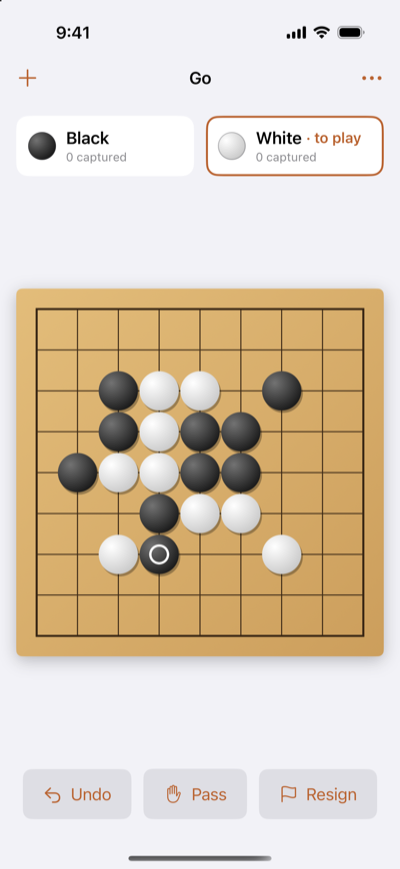
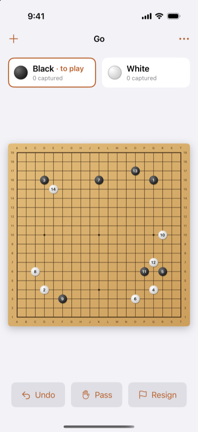
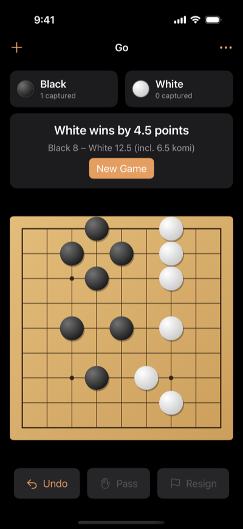

# The Game of Go

Apps for playing [Go](https://en.wikipedia.org/wiki/Go_(game)) (碁 / wéiqí / baduk), the ancient two-player strategy board game. Two people take turns on the same device, tapping the board to place black and white stones.

The repository has two versions:

- **`iOS/`**: a modern SwiftUI app for iPhone and iPad (see [iOS app](#ios-app) below)
- **`Go/` and `GoTest/`**: the original Android app, an early-stage hobby project from 2011 for Android 2.2 (API level 8), built as an Eclipse ADT project. The rest of this README up to the iOS section describes this version.

## Features

- **9×9 board** drawn on a custom `View`, with grid lines and star points
- **Two players on one device:** Black and White alternate turns, starting with Black
- **Capturing:** a group with no liberties left is removed from the board
- **Suicide prevention:** a move that leaves your own stone with no liberties is rejected, unless it captures an opponent's stone
- **Status display:** shows how many stones each colour has lost and whose turn it is
- **Survives rotation:** the board is saved in `onSaveInstanceState`, so turning the device doesn't lose the game
- **Debug "Print Board":** tap the *Print Board* label under the board to write the move history to Logcat (tag `Go`), with each stone labelled by move number (e.g. `B1`, `W2`; lowercase means the stone was captured)

## Project layout

```
Go/                         The Android application (Eclipse ADT project)
  AndroidManifest.xml
  src/charland/games/go/
    Go.java                 Main menu: Continue, New Game, About, Exit, plus a Settings menu item
    Game.java               Game activity: turn order, capture counts, state saving
    Board.java              Board model: placing stones, counting liberties, captures, text dump
    Point.java              A board coordinate (plus whether the stone there is still alive)
    PuzzleView.java         Draws the board, stones and stats; turns taps into moves
    About.java              About dialog
    Prefs.java              Settings screen (Music, Hints)
  res/                      Layouts, strings, colours, menu, preferences, icons
  test/charland/games/go/   JUnit 4 + Robolectric tests for Board, Game, Point, PuzzleView
GoTest/                     Eclipse project that runs the tests (bundles robolectric-0.9.4-all.jar)
```

## How the rules are implemented

The board is a `short[9][9]` in which each cell is `EMPTY` (-1), `BLACK` (0) or `WHITE` (1). When a player taps a point, `Game.playTurn`:

1. Rejects the move if the point is already occupied.
2. Calls `Board.occupyBlack` or `Board.occupyWhite`. These place the stone, then count its liberties with a recursive flood fill over connected same-coloured stones. If the stone has no liberties and doesn't put a neighbouring opponent stone in atari, the move counts as suicide and is rejected.
3. If the move is legal, it calls `Board.checkAllLibertiesFor` on the opponent's colour, removes any of their stones that have no liberties left, and adds them to the capture count.
4. Moves on to the next turn.

## Building and running

The project predates Gradle and Android Studio. It was built with Eclipse, the ADT plugin and the Android SDK's `android-8` platform.

1. Install an Android SDK with the **API 8 (Android 2.2)** platform.
2. In Eclipse with ADT, choose **File → Import → Existing Projects into Workspace** and import `Go/` and `GoTest/`.
3. Run `Go` as an Android application on an emulator or device.

To build it with a current toolchain, import `Go/` into Android Studio, which will offer to convert it to Gradle, then raise `minSdkVersion` and `targetSdkVersion` as needed.

### Running the tests

The tests use JUnit 4 and [Robolectric](http://robolectric.org/) 0.9.4, so they run on the JVM without an emulator. Run `GoTest/GoTest.launch` from Eclipse. Before you do:

- `GoTest/.classpath` hard-codes the location of `android.jar` (`D:/Android/android-sdk-windows/platforms/android-8/android.jar`). Point it at your own SDK.
- The test sources are in `Go/test/`, but `GoTest/.classpath` expects a `test` folder inside `GoTest/`. Link or copy the folder, or change the classpath entry.

Many tests draw the board positions they set up in ASCII, which makes the capture scenarios easy to follow.

## Status and known limitations

This is a work in progress. Missing features include:

- Only 9×9 boards are supported (`Board.SIZE`)
- No ko rule, no passing, and no end-of-game detection or scoring
- No computer opponent
- The **Music** and **Hints** settings are shown but don't do anything yet
- **Continue** and **New Game** both start a new game; games are not saved between app sessions

## iOS app

`iOS/` is a rewrite of the Android app in Swift 6 and SwiftUI for iOS 18 and later, on iPhone and iPad. Besides the original features, it fills in most of the gaps listed above.

<p align="center">
  
  &nbsp;
  
  &nbsp;
  
</p>
<p align="center"><em>Left to right: a 9×9 game in progress, a 19×19 board with coordinates and move numbers turned on, and a finished game in dark mode.</em></p>

| | Android (2011) | iOS |
|---|---|---|
| Board sizes | 9×9 | 9×9, 13×13, 19×19 |
| Captures and suicide rule | ✓ | ✓ |
| Ko | — | ✓ (positional superko) |
| Pass, resign, end of game | — | ✓ Two passes in a row end the game, which is then scored |
| Scoring | — | Area (Chinese) scoring with adjustable komi |
| Undo | — | ✓ Unlimited |
| Continue a game after relaunch | — (Continue started a new game) | ✓ Saved automatically |
| "Print Board" | Writes to Logcat | **Share Board** sends a text diagram to the share sheet |
| Settings | Music and Hints (did nothing) | Last-move marker, move numbers, coordinates, haptics |
| Accessibility | — | VoiceOver can read and play every intersection; Dynamic Type; dark mode |

### Layout

```
iOS/
  project.yml                 XcodeGen spec (the source of truth for GoGame.xcodeproj)
  GoGame.xcodeproj            Generated project, committed so it opens directly in Xcode
  GoEngine/                   Swift package with the platform-independent rules engine
    Sources/GoEngine/
      Board.swift             Stones, groups and liberties, star points, text diagram
      Game.swift              Turns, captures, ko, pass/resign, undo, scoring (Codable)
    Tests/GoEngineTests/      Swift Testing suite, including ports of the Android capture tests
  GoGame/                     The SwiftUI app
    GoGameApp.swift
    GameStore.swift           @Observable store: applies moves, saves the game as JSON
    Views/                    GameView, BoardView (Canvas), NewGameView, SettingsView, AboutView
    Assets.xcassets           App icon and accent colour
```

### Building

Requires Xcode with the iOS 18 SDK or later.

```sh
cd iOS
open GoGame.xcodeproj           # then run the GoGame scheme on a simulator or device
```

After changing `project.yml` or adding files, regenerate the project with `xcodegen generate` (`brew install xcodegen`).

### Testing

The rules engine doesn't depend on UIKit or SwiftUI, so its tests run on macOS from the command line:

```sh
cd iOS/GoEngine
swift test
```

The tests also run in Xcode from the GoGame scheme (⌘U).

### Limitations

- Scoring counts every stone on the board as alive, so players must capture dead stones before passing.
- There's no computer opponent, no online play, and no SGF import or export.
